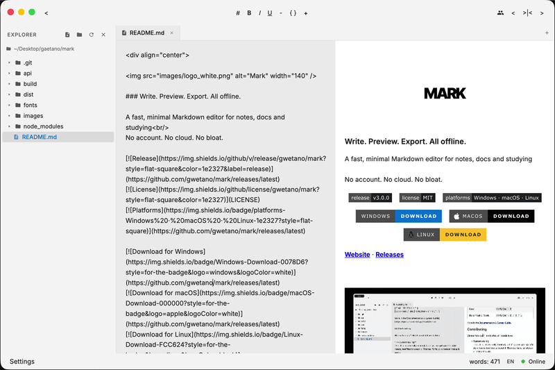

<div align="center">


### Write. Preview. Export. All offline.

A fast, minimal Markdown editor for notes, docs and studying<br/>
No account. No cloud. No bloat.

[](https://github.com/gwetano/mark/releases/latest)
[](https://github.com/gwetano/mark/releases/latest)
[](LICENSE)
[](https://github.com/gwetano/mark/releases/latest)

[](https://github.com/gwetano/mark/releases/latest)
[](https://github.com/gwetano/mark/releases/latest)
[](https://github.com/gwetano/mark/releases/latest)

[**Website**](https://gwetano.vercel.app/mark/) · [**Releases**](https://github.com/gwetano/mark/releases)

<br/>



</div>

<br/>

## Why Mark

Most editors are too heavy and want your data in their cloud. Mark opens folders, edits `.md` files and saves them. That's it.

## Features

- **Live preview**: split, editor-only or preview-only
- **Folder explorer**: open a whole folder and jump between notes
- **Real-time collaboration (Beta)**: peer-to-peer live editing via WebRTC with no account required
- **Export to PDF**: with clickable table of contents and custom image sizes
- **Export to HTML**: turn your docs into a ready-to-publish page
- **Math**: LaTeX formulas with KaTeX
- **100% local**: no uploads, no tracking, works offline
- **Light & dark theme**

## Quick start

1. Download the build for your system from the [latest release](https://github.com/gwetano/mark/releases/latest)
2. Open a folder (`Ctrl/Cmd + Shift + O`)
3. Write. Export when done.

### Build from source

```bash
git clone https://github.com/gwetano/mark.git
cd mark
```

```bash
bash lin-install.sh     # Linux
bash mac-install.sh     # macOS
./win-install.bat       # Windows
```

## Tips

**Image size in PDF**: add a tag to the alt text.

```md
![Diagram[small]](img.png)    <!-- 25% -->
![Diagram[medium]](img.png)   <!-- 50% -->
![Diagram[large]](img.png)    <!-- 75% -->
![Diagram[full]](img.png)     <!-- 100% -->
```

## Shortcuts

| Action | Shortcut |
|---|---|
| Save | `Ctrl/Cmd + S` |
| New file | `Ctrl/Cmd + N` |
| Open file / folder | `Ctrl/Cmd + O` / `Shift + O` |
| Toggle theme | `Ctrl/Cmd + M` |
| Toggle explorer | `Ctrl/Cmd + R` |
| Find | `Ctrl/Cmd + F` |
| Bold / Italic / Link | `Ctrl/Cmd + B` / `I` / `L` |

More in the [Documentation & Syntax Guide](https://gwetano.vercel.app/mark/docs/).

## Contributing

Wanna help out? Here’s what still needs love:

* **Custom styling**  
The UI is intentionally minimal, but if you’ve got specific style needs, feel free to tweak it. Themes, fonts, or whatever makes it yours.

* **Real-time Collaboration & Shared Documents (Beta)**  
Collaboration via P2P WebRTC is in active beta. We are continually refining how shared documents sync, state persistence on session files, and multi-user edge cases when participants connect or edit concurrently. Testing collaborative sessions, reporting sync quirks, or opening pull requests to improve the sharing flow is super welcome!

## License 

Do whatever you want with it. If you improve it, fork it. If it helps you, let me know.